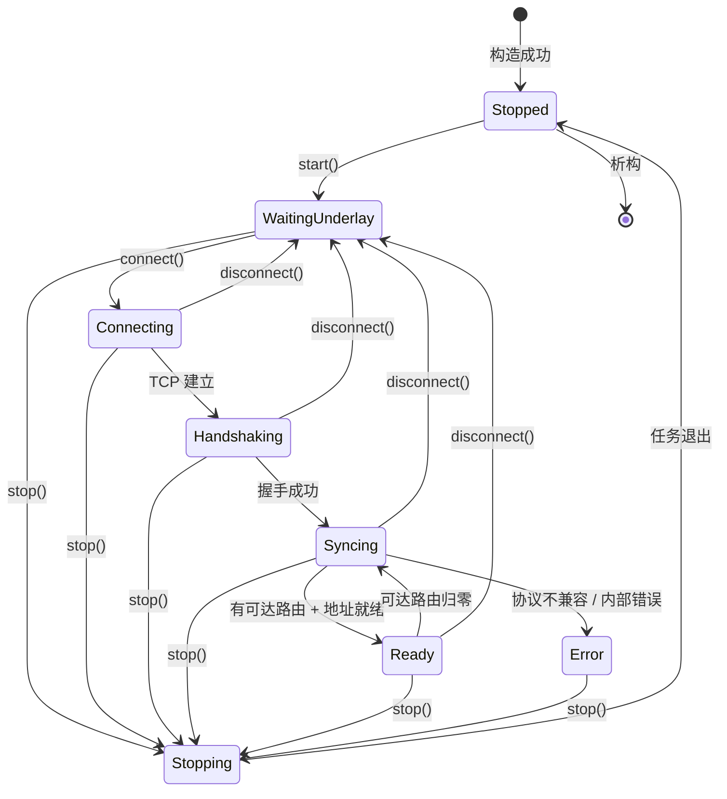
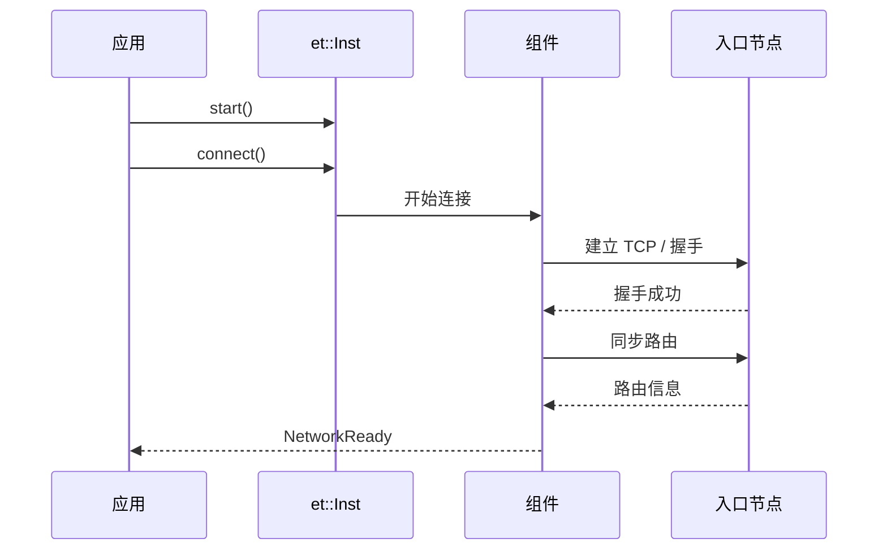

## 状态

`et::State` 共 9 个值：

| 状态 | 含义 |
| --- | --- |
| `Uninitialized` | 尚未成功配置（构造失败时可能看到） |
| `Stopped` | 已配置但未启动；构造完成后、`start()` 前 |
| `WaitingUnderlay` | 已启动，等待应用 `connect()`，或 `disconnect()` 后 |
| `Connecting` | 正在连接入口节点 |
| `Handshaking` | TCP 已建立，正在握手 |
| `Syncing` | 握手完成，正在同步路由 |
| `Ready` | 组网可用：有可达路由且虚拟地址已就绪 |
| `Stopping` | 正在停止 |
| `Error` | 出错，见 `Status::last_error` |

### 迁移图



## 事件

`et::EventType` 共 6 个值：

| 事件 | 何时产生 | 携带信息 |
| --- | --- | --- |
| `Started` | 控制面任务进入主循环 | 初始 `Status` |
| `PeerUp` | 某个入口握手成功 | `peer_id`、当前 `Status` |
| `NetworkReady` | 首次满足 Ready 条件 | `virtual_ipv4`、`prefix_len`、计数 |
| `PeerDown` | **预留，当前不产生** | — |
| `Error` | 运行期错误；已 Ready 后协议不兼容会补发 | `status.last_error` |
| `Stopped` | 控制面任务退出前 | 最终 `Status` |

事件回调函数在控制面任务中**同步**执行：

```cpp
void on_event(const et::Event& event, void*) noexcept {
    // 必须快速返回
}
```

允许：只读接口、`connect()`、`disconnect()`。  
禁止：`stop()`、析构、长时间阻塞。

## Ready 的判定

组件在路由与地址都就绪后检查：

```text
有可达路由
且 虚拟地址已就绪
且 至少一个对端已握手
```

满足才置 `Ready` 并发出 `NetworkReady`。

这解释了两个常见现象：

1. **TCP 连上、握手成功，但仍不是 Ready**：路由还没同步到可达节点；
2. **有路由但虚拟地址还是 0**：DHCP 还没分配或网卡未创建。

## 掉出 Ready

- 可达路由归零：回到 `Syncing`；
- 对端使用 Zstd 压缩等不兼容行为：进入 `Error`，并在已上报过 Ready 时补发一次 `Error`；
- `disconnect()`：直接回 `WaitingUnderlay`。

## 典型时序



## 读状态的建议

```cpp
et::Status s{};
if (inst.get_status(s) == ESP_OK) {
    switch (s.state) {
        case et::State::Ready: /* 可用 */ break;
        case et::State::Error: /* 看 s.last_error */ break;
        default: /* 过渡态 */ break;
    }
}
```

不要只根据 `start()` 的返回值判断可用性，也不要把 `PeerUp` 当成 `NetworkReady`。
