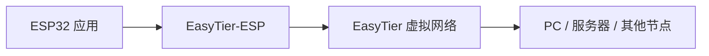

import { Card, CardGrid, LinkCard, Aside } from '@astrojs/starlight/components';

**EasyTier-ESP** 是一个使用 C++20 编写的 ESP-IDF 组件，用于把 ESP32 接入既有的 EasyTier 虚拟网络。它把“接入网络”所需的连接、加密、路由与虚拟网卡封装成一个 `et::Inst`，让嵌入式应用不必自己处理这些细节。

<Aside type="note" title="当前验证范围">
  适配 ESP-IDF 6.1.x，已在 **ESP32-S3-N16R8** 上验证。ESP-IDF 的组件声明是 `>=6.1`，但未验证的版本与芯片不承诺行为一致。
</Aside>

## 项目特点

<CardGrid>
  <Card title="接入现有网络" icon="puzzle">
    ESP32 作为客户端加入你已经在运行的 EasyTier 网络，不需要重建网络，也不需要公网 IP。
  </Card>
  <Card title="一个 RAII 类" icon="rocket">
    公开 API 只有 `et::Inst`：TOML 构造、启动、连接、断开、停止与状态查询，集成路径清晰。
  </Card>
  <Card title="资源有界" icon="setting">
    固定容量队列与缓冲，长期运行不无限增长；连接数、队列深度、任务栈都可在 Kconfig 中调整。
  </Card>
  <Card title="数据加密" icon="approve-check">
    数据面使用 AES-128-GCM 加密；可在配置中关闭。
  </Card>
  <Card title="lwIP 虚拟网卡" icon="laptop">
    创建标准 lwIP 虚拟网卡，应用像访问本地网络一样访问虚拟 IP，物理网卡继续正常上网。
  </Card>
  <Card title="多实例" icon="random">
    每个实例独占连接、队列、任务与网卡，可在同一设备上接入不同网络。
  </Card>
</CardGrid>

## 适用场景

<CardGrid>
  <Card title="远程设备管理" icon="laptop">
    设备部署在 NAT 或防火墙之后，仍然可以从办公网或云端访问它的 Web 服务、调试接口与数据端口。
  </Card>
  <Card title="家庭与办公室组网" icon="puzzle">
    把传感器、控制器、网关接入已有的 EasyTier 网络，与 PC、NAS、服务器处于同一个虚拟网段。
  </Card>
  <Card title="边缘节点接入" icon="setting">
    让 ESP32 作为边缘节点加入多跳网络，与中心服务器或其他边缘设备直接通信。
  </Card>
</CardGrid>

## 工作方式

组件在 ESP32 上创建一块虚拟网卡，应用通过它发送和接收 IP 报文；组件负责连接入口、同步路由、加密数据并把报文送到虚拟网络中的目标节点。对应用来说，它只是多了一块可以访问 `10.x.x.x` 的网卡。

## 兼容性

| 项目 | 当前状态 |
| --- | --- |
| ESP-IDF | 6.1.x 已验证；组件声明 `>=6.1` |
| 芯片 | ESP32-S3-N16R8 已验证；其他型号未验证 |
| 入口传输 | TCP 客户端（`tcp://host:port`） |
| 加密 | AES-128-GCM；支持关闭加密 |
| 虚拟地址 | 静态 IPv4 或 DHCP 自分配 |
| 组件版本 | `myqfeng/easytier-esp` 0.0.2 |
| 许可证 | LGPL-3.0 |

完整的支持范围与限制见 [能力矩阵](/guide/getting-started/capabilities/)。

## 开始阅读

<CardGrid>
  <LinkCard
    title="项目概览"
    description="组件定位、项目特点、适用场景与能力边界。"
    href="/guide/"
  />
  <LinkCard
    title="TOML 配置参考"
    description="网络名、密钥、入口、虚拟地址与 MTU 的完整字段说明。"
    href="/guide/config/toml-reference/"
  />
  <LinkCard
    title="API 参考"
    description="et::Inst、Settings、State、Event、Status 与错误码。"
    href="/api/"
  />
  <LinkCard
    title="常见问题"
    description="选型、部署、配置与运行期的高频问题。"
    href="/appendix/faq/"
  />
</CardGrid>

## 开源

EasyTier-ESP 采用 **LGPL-3.0** 许可证，代码托管在 CNB，并同步到 GitHub。组件可通过 ESP-IDF 组件注册表安装，也可以直接使用仓库中的 `components/easytier-esp` 源码。

- [组件注册表](https://components.espressif.com/components/myqfeng/easytier-esp)
- [主仓库（CNB）](https://cnb.cool/myqfeng/qteasytier/easytier-esp)
- [GitHub 镜像](https://github.com/easytier/easytier-esp)
